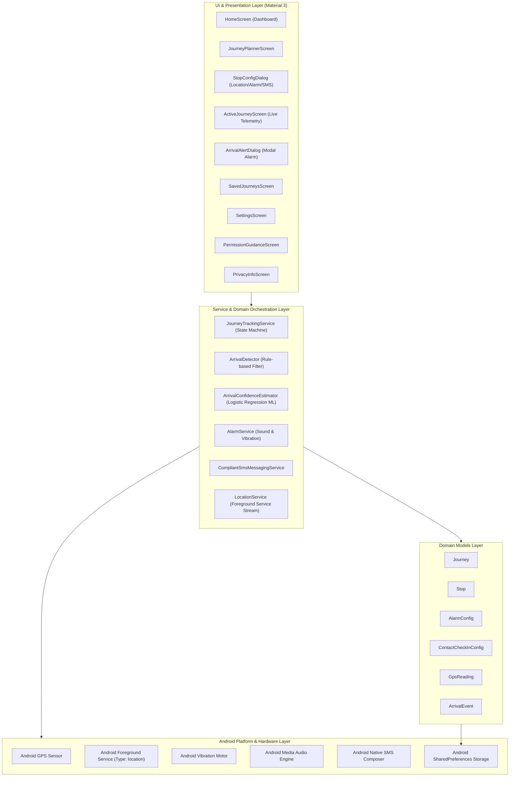
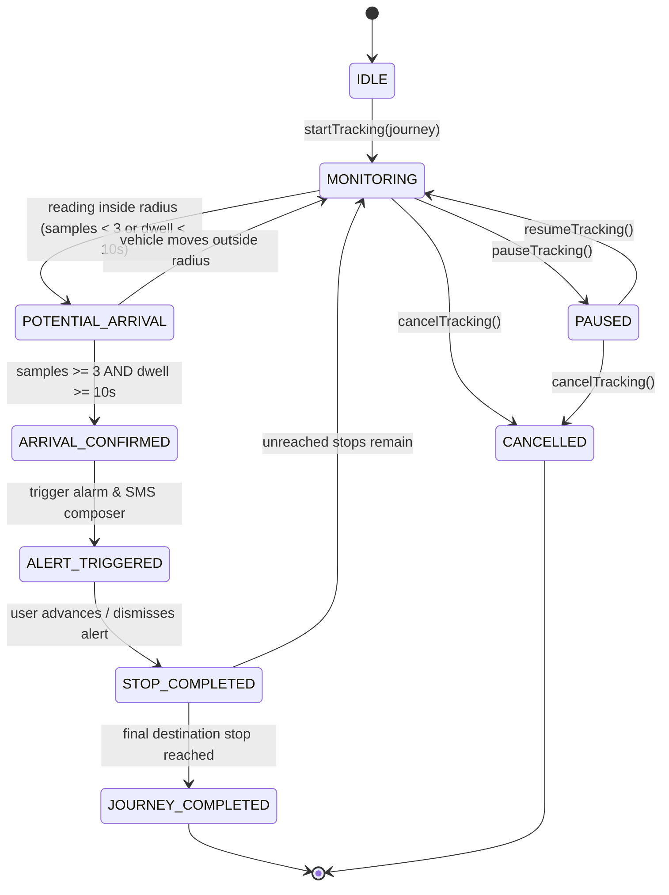

# YatraSaathi — Architecture Specification

## 1. System Overview

YatraSaathi is a local-first, privacy-focused transit companion application for Android. It assists travelers on multi-stop journeys (metro, suburban rail, commuter bus) by monitoring real-time GPS coordinates, validating station arrivals, triggering audible and tactile alarms, and opening native SMS composer check-in messages.

### Core Architectural Principles
1. **Local-First & Zero Backend:** All journey data, coordinates, contacts, and logs persist locally via encrypted or private platform storage (`SharedPreferences`). No cloud infrastructure, user accounts, or external analytics exist.
2. **Deterministic Safety Primary:** Geographic arrival detection is enforced by an immutable rule-based engine requiring multi-sample consistency and minimum dwell duration before any alert can fire.
3. **Assistive Machine Learning:** An on-device ML model evaluates trajectory features (speed, drift, dwell, convergence) to output an interpretable arrival confidence score (\(0.0 \dots 1.0\)). It serves as assistive verification, never overriding deterministic physical safety gates.
4. **Honest Google Play Compliance:** The application refuses silent background SMS dispatches. Instead, it leverages Android's compliant `sms:` intent composer scheme, leaving delivery confirmation transparently in user control.

---

## 2. Layered Architecture Diagram

---

## 3. Arrival State Machine

The active journey lifecycle is governed by an explicit 9-state machine:

---

## 4. Subsystems Detail

### A. Distance Calculation (Haversine Algorithm)
Great-circle spherical distance between current GPS point \((\phi_1, \lambda_1)\) and target stop \((\phi_2, \lambda_2)\):
\[
a = \sin^2\left(\frac{\Delta\phi}{2}\right) + \cos(\phi_1)\cos(\phi_2)\sin^2\left(\frac{\Delta\lambda}{2}\right)
\]
\[
c = 2 \cdot \text{atan2}\left(\sqrt{a}, \sqrt{1-a}\right)
\]
\[
d = R \cdot c \quad (R = 6,371,000\text{ meters})
\]

### B. Arrival Detection Rules
1. **Coordinate Validity:** Latitude \(\in [-90, 90]\), Longitude \(\in [-180, 180]\).
2. **Freshness Filter:** Reading age \(\le 45\text{ seconds}\). Rejects stale cached fixes.
3. **Accuracy Filter:** Horizontal error \(\le 50\text{ meters}\). Rejects cell-tower multipath drift.
4. **Consecutive Consistency:** Minimum 3 successive readings inside the stop's configured radius.
5. **Dwell Duration:** Minimum 10 seconds elapsed inside the arrival perimeter.
6. **Duplicate Event Suppression:** A stop ID is marked handled after arrival; repeated alerts are suppressed.

### C. Background Execution Architecture
- Utilizes Android's `ForegroundService` with `foregroundServiceType="location"`.
- Displays an ongoing, non-dismissible notification in the Android notification drawer informing the traveler of their upcoming stop.
- Acquires wake locks when in arrival proximity to guarantee alert execution even while device screen is locked.

