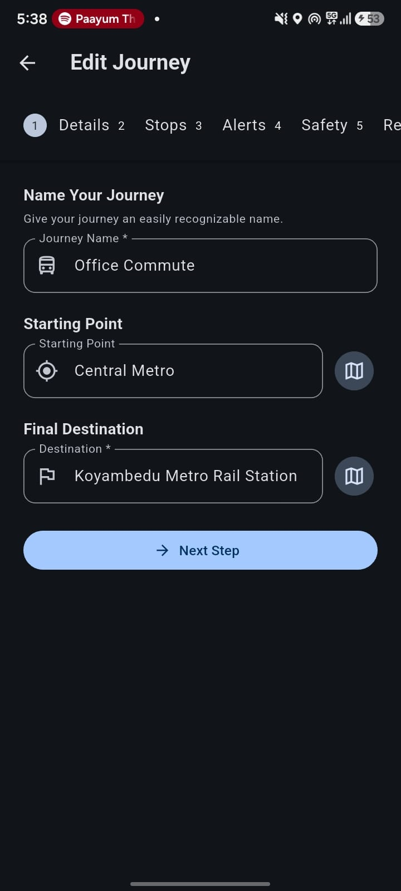
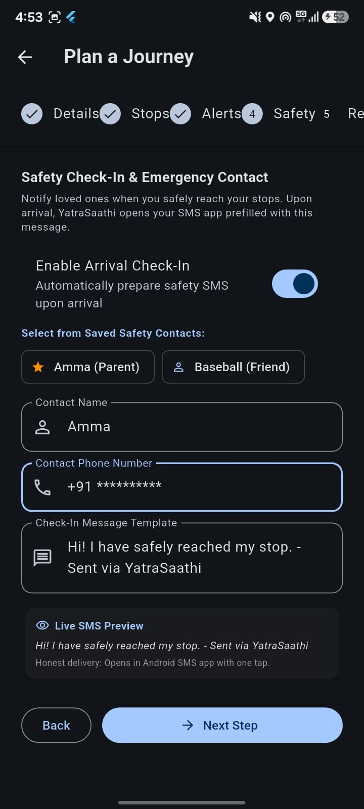
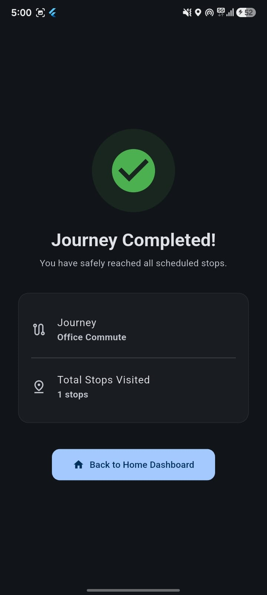
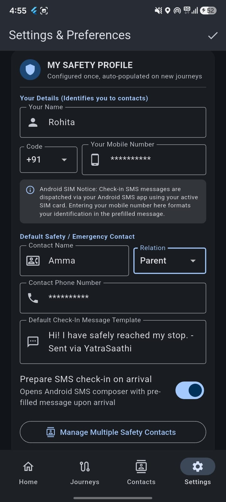
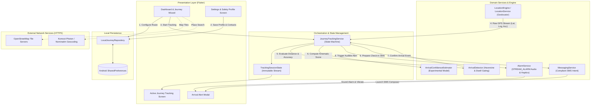

# YatraSaathi

**A location-aware journey companion for arrival alerts, GPS tracking, and safety check-ins.**

[](LICENSE)
[](https://flutter.dev)
[](https://dart.dev)
[]()
[](https://developer.android.com)
[](PRIVACY_POLICY.md)
[](docs/RELEASE_NOTES_v1.0.0.md)

---

## Problem Statement

Travellers can become distracted, fall asleep, or miss their intended stops, especially during long commutes and unfamiliar journeys. Public transit delays, traffic congestion, and variable transit schedules make conventional clock-based alarms unreliable because an alarm scheduled for an estimated time may fire miles before reaching the station or long after missing an interchange. 

At the same time, remembering to notify family members or emergency contacts after reaching a destination adds an unnecessary cognitive burden during the rush of disembarking. Existing navigation applications typically demand continuous active screen time, drain device batteries through constant graphic rendering, and rely heavily on cloud accounts and remote telemetry.

YatraSaathi addresses these transit challenges with a dedicated, location-aware travel companion that combines deterministic destination proximity monitoring, high-priority hardware arrival alarms, and arrival-triggered safety check-ins within a 100% on-device, privacy-first mobile architecture.

---

## About YatraSaathi

YatraSaathi is a mobile journey monitoring and travel safety application built with Flutter for Android. Designed specifically for daily commuters, bus passengers, rail travellers, and students, the application actively monitors physical travel progress in the background and ensures passengers never overshoot their stop.

"I tend to miss my stop while travelling. I wanted an application that could alert me when I reached a planned location and help notify my family, so I wouldn't have to remember to send a check-in message every time."

This everyday transit challenge shaped the engineering of YatraSaathi:

- **Journey Planning:** Users configure journeys by setting intermediate stops and final destinations, choosing geocoded locations via an interactive OpenStreetMap picker or text search, and assigning custom arrival alert radii ($200\text{ m}$ to $2\text{ km}$).
- **GPS Monitoring & Arrival Detection:** While transit is underway, an Android Foreground Service reads device GPS coordinates and calculates spherical distances using the Haversine formula. To prevent false alarms, the detection engine validates horizontal GPS accuracy, enforces temporal freshness, and requires multi-sample dwell time within the stop boundary before confirming arrival.
- **Hardware-Level Alerts:** Unlike standard notifications that can easily be muted or overlooked, arrival triggers loud audio routed through Android's `STREAM_ALARM` audio context, cutting through noisy transit even when the device is silenced.
- **Safety Check-in Workflows:** Upon confirmed arrival, YatraSaathi prepares a personalized check-in message and invokes the native Android SMS composer pre-filled with the designated emergency contact, allowing travellers to confirm safe arrival with a single tap.

---

## Key Features

### Journey Management
- **Multi-Stop Route Planning:** Create journeys containing multiple sequential stops and interchange stations.
- **Origin & Destination Configuration:** Define named departure points and final destinations with clear transit labels.
- **Saved Journeys:** Store and manage frequently travelled routes locally for one-tap tracking activation.
- **Stop Sequencing & Custom Radii:** Reorder stops dynamically and configure individualized alert radii ($200\text{ m}$, $500\text{ m}$, $1\text{ km}$, $2\text{ km}$) per stop.

### Location Intelligence
- **GPS-Based Journey Tracking:** Continuous on-device distance calculation between live coordinates and upcoming destinations.
- **Kinematic Distance Countdown:** Real-time distance-to-destination readout updated continuously during transit.
- **Deterministic Arrival Detection:** Rule-based arrival engine enforcing consecutive consistent fixes and dwell-time validation.
- **Telemetry & Signal Freshness:** Live diagnostic monitoring of GPS accuracy ($\pm\text{metres}$), fix timestamp age, and device travel speed.
- **Experimental Arrival Confidence:** Integrated on-device logistic regression classifier displaying experimental arrival confidence ($0\text{--}100\%$) alongside verified rule-based status.

### Arrival Alerts
- **High-Priority Audible Alarms:** Audio routed through Android `STREAM_ALARM` to guarantee audible alerts through device speakers.
- **Tactile Vibration Patterns:** Synchronized hardware vibration cadences for pocket awareness.
- **Packaged Local Ringtones:** Three original locally packaged `.wav` ringtones (*Classic Ring*, *Urgent Arrival Alarm*, *Gentle Chime*) with instant in-app auditioning and volume control.
- **Alarm Cadence Controls:** Configurable alert repeats ($1\text{--}5\text{ times}$ or loop until dismissed) and a $5\text{-minute}$ snooze timer.

### Safety Check-ins
- **Emergency Contact Directory:** Save trusted emergency contacts locally with relationship tags (*Parent*, *Partner*, *Sibling*, *Friend*).
- **Personalized Message Templates:** Customizable check-in SMS templates that auto-populate station names.
- **Arrival-Triggered SMS Preparation:** Automated message generation immediately upon confirmed destination arrival.
- **Native Android SMS Composer Integration:** Dispatches messages transparently through the user's native SMS application via `sms:` intents, ensuring complete user control and zero unauthorized message transmission.

### Journey Monitoring
- **Active Journey Dashboard:** Dedicated tracking view featuring live route map, next-stop banner, and countdown metrics.
- **Route Progress Map:** Hardware-accelerated OpenStreetMap rendering displaying current position, route polyline, and target stop alert radius.
- **Arrival Notification Modal:** High-visibility arrival dialog with dismiss, snooze, and SMS composer shortcuts.
- **Journey Completion Summary:** Post-trip summary displaying total stops completed and trip completion confirmation.
- **Manual Arrival Override:** Manual confirmation action allowing users to advance stops if travelling through GPS dead zones.

---

## Application Screenshots

The following screenshots capture the complete end-to-end journey lifecycle from the installed YatraSaathi Android application:

| | |
| :---: | :---: |
| **01 — Home Dashboard** | **02 — Journey Creation** |
|  |  |
| Active journey banner, quick planning actions, and saved journeys | Multi-step route wizard with journey name, origin, and destination |
| **03 — Interactive Map Picker** | **04 — Stop Configuration** |
|  |  |
| OpenStreetMap location selection with draggable pin and search | Intermediate stop sequence with customizable 500 m alert radius |
| **05 — Arrival Alert Preferences** | **06 — Safety Check-in** |
|  |  |
| Audible chime toggle, vibration, 3-repeat alert cadence, and snooze | Emergency contact selector with masked number and live SMS preview |
| **07 — Active Journey Tracking** | **08 — Arrival Notification** |
|  |  |
| Real-time distance countdown, route map, and GPS diagnostics | Arrival alert modal with alarm icon, snooze, and SMS composer action |
| **09 — Journey Completed** | **10 — Safety Profile** |
|  |  |
| Journey completion summary confirming all scheduled stops visited | Passenger identity, default emergency contact, and message template |

> [!NOTE]
> All ten screenshots are genuine Android captures. Phone numbers are masked directly in the interface with asterisks. Complete specifications are documented in [`assets/screenshots/README.md`](assets/screenshots/README.md).

---

## System Architecture

YatraSaathi is designed as an offline-first, layered client architecture. Core business logic, geospatial mathematics, hardware alert services, and local persistence operate entirely on the mobile device without external cloud dependencies.



### Architectural Layers

1. **Presentation Layer (`lib/ui/`):** Implements Flutter widgets and screens across a responsive Material 3 design system. Encapsulates the multi-step journey wizard (`journey_wizard_screen.dart`), active tracking interface (`active_journey_screen.dart`), interactive map view (`journey_map_view.dart`), map location picker (`map_location_picker.dart`), and settings profile (`settings_screen.dart`).
2. **Orchestration Layer (`lib/services/journey_tracking_service.dart`):** Acts as the central active journey state machine (`TrackingState`: `idle` $\rightarrow$ `monitoring` $\rightarrow$ `potentialArrival` $\rightarrow$ `arrivalConfirmed` $\rightarrow$ `alertTriggered` $\rightarrow$ `stopCompleted` $\rightarrow$ `journeyCompleted`). Emits immutable `TrackingSessionState` snapshots to the UI.
3. **Arrival Detection Engine (`lib/services/arrival_detector.dart`):** Executes deterministic geospatial verification using spherical distance calculations (`distance_calculator.dart`). Enforces noise filters ($> 65\text{ m}$ rejected), sample age limits ($< 45\text{s}$), multi-reading confirmation ($\ge 2$ consecutive fixes), and dwell thresholds ($4\text{s}$ to $10\text{s}$) to eliminate false alarms.
4. **Experimental Arrival Confidence Engine (`lib/services/arrival_confidence_ml.dart`):** An on-device logistic regression classifier that evaluates current kinematic parameters (speed, distance ratio, dwell ratio, convergence rate) to display an experimental probability score ($0\text{--}100\%$) indicating arrival likelihood.
5. **Hardware Alerting & Audio Layer (`lib/services/alarm_service.dart`):** Configures `AudioContextAndroid` with `usageType: AndroidUsageType.alarm` (`STREAM_ALARM`) to ensure alarms ring through device speakers even in silent mode. Controls audio loop timers, preview playback, hardware vibration patterns (`vibration`), and system notifications (`notification_service.dart`).
6. **Messaging Layer (`lib/services/messaging_service.dart`):** Implements `CompliantSmsMessagingService`, preparing personalized arrival messages and launching the native Android SMS client via `url_launcher` (`sms:` intent). Supports an optional direct telephony service (`direct_sms_service.dart`) strictly for private user-consented builds.
7. **Local Persistence Layer (`lib/services/journey_repository.dart`):** Manages local storage of user journeys, passenger profile, and emergency contacts in private Android `SharedPreferences`.

---

## Technology Stack

The complete technology stack is verified directly against `pubspec.yaml` and the repository source code:

| Technology | Package / Version | Purpose |
| :--- | :--- | :--- |
| **Flutter** | Framework `3.47.8` (Channel stable) | Core cross-platform application framework |
| **Dart** | SDK `3.13.7` | Client programming language |
| **Android SDK** | API 26 to API 34+ | Platform integration, foreground services, and audio routing |
| **Geolocator** | `geolocator ^13.0.2` | High-accuracy GPS location streams and background foreground service |
| **Flutter Map** | `flutter_map ^7.0.2` & `latlong2 ^0.9.1` | Hardware-accelerated map rendering and coordinate mathematics |
| **Audioplayers** | `audioplayers ^6.1.0` | Audio playback configured with Android `STREAM_ALARM` audio context |
| **Vibration** | `vibration ^2.1.0` | Device haptic feedback and custom vibration cadence patterns |
| **Local Notifications** | `flutter_local_notifications ^18.0.1` | High-priority arrival notification channels and persistent service banners |
| **Local Storage** | `shared_preferences ^2.5.6` | Private on-device key-value persistence for journeys, profiles, and settings |
| **URL Launcher** | `url_launcher ^6.3.1` | Invocation of native Android SMS composer (`sms:` intent scheme) |
| **HTTP Client** | `http ^1.2.2` | Network requests for Komoot Photon place search and Nominatim geocoding |
| **Flutter Test** | `flutter_test` (SDK) | Automated unit, widget, and integration test execution |

---

## References and Design Rationale

### 1. Flutter & Dart for Real-Time Transit UI
Flutter was chosen because its compiled native execution (AOT compilation) delivers smooth 60fps animations and instant UI responsiveness on mobile hardware. Dart's reactive stream architecture (`StreamController`, `StreamSubscription`) maps naturally to real-time GPS telemetry streams and background state machines.

### 2. Location-Based vs. Time-Based Arrival Detection
Conventional clock alarms fail in public transit because train and bus travel times fluctuate significantly due to traffic, track maintenance, and signal halts. Calculating live spherical distance to destination coordinates guarantees that arrival alerts sound exactly when the physical destination is approached, regardless of transit schedule deviations.

### 3. Adjustable Arrival Radii
Transit environments have diverse operational scales:
- **$200\text{ m}$:** Ideal for urban bus stops and pedestrian walking commutes.
- **$500\text{ m}$:** Ideal for standard city metro and tram stops, allowing passengers time to gather belongings and move to doors.
- **$1\text{ km}$ to $2\text{ km}$:** Essential for high-speed intercity trains, where high deceleration distances require alerting passengers several minutes before pulling into junction platforms.

### 4. OpenStreetMap & Flutter Map Integration
Rather than relying on proprietary mapping SDKs that require developer API keys, billing accounts, and user tracking, YatraSaathi integrates OpenStreetMap tiles via `flutter_map`. This open architecture enables reliable tile rendering, zero vendor lock-in, and transparent network communications.

### 5. Android SMS Composer Intent Integration
Google Play permissions policy strictly limits the `SEND_SMS` background permission to default SMS handler apps. To ensure full compliance with Android security standards and maintain user autonomy, YatraSaathi utilizes the native Android SMS composer intent (`sms:`) as its default workflow. The message and recipient are pre-filled upon arrival, but the user explicitly reviews and taps "Send".

### 6. Local-First SharedPreferences Architecture
Travellers frequently pass through areas with intermittent or zero cellular connectivity (underground metro tunnels, rural railway corridors). Storing itineraries, passenger profiles, and emergency contacts in local `SharedPreferences` ensures the application functions reliably without server availability.

### 7. GPS Accuracy Gating & Temporal Freshness
Mobile GPS receivers often deliver inaccurate multipath readings when passing between skyscrapers or under steel railway overpasses. YatraSaathi's `ArrivalDetector` discards location fixes with horizontal accuracy $> 65\text{ m}$ and timestamps $> 45\text{ seconds}$ old. Furthermore, arrival is confirmed only after at least 2 consecutive valid readings occur within the radius combined with minimum dwell-time validation, preventing false alerts on express trains bypassing intermediate stations.

### 8. Experimental Arrival Confidence vs. Confirmed Arrival
The active journey screen features an experimental arrival confidence indicator powered by an on-device logistic regression classifier (`ArrivalConfidenceEstimator`). This model evaluates kinematic telemetry (speed, convergence rate, distance ratio) to provide an exploratory estimate of arrival likelihood. However, hardware alarms and safety check-ins are triggered **strictly by the deterministic, rule-based `ArrivalDetector`**, ensuring safety-critical alarms never depend on an unvalidated statistical prediction.

### Official Documentation References
- [Flutter Framework Documentation](https://docs.flutter.dev/)
- [Dart Language & Core Libraries](https://dart.dev/guides)
- [Android Location & Sensors Guide](https://developer.android.com/develop/sensors-and-location/location)
- [Android App Permissions Overview](https://developer.android.com/training/permissions)
- [Android Common Intents (SMS / Messaging)](https://developer.android.com/guide/components/intents-common#Messaging)
- [OpenStreetMap Foundation & Tile Usage Policy](https://operations.osmfoundation.org/policies/tiles/)
- [flutter_map Documentation](https://docs.fleaflet.dev/)

---

## Getting Started

### Prerequisites
- [Flutter SDK](https://docs.flutter.dev/get-started/install) (version `3.47.8` or compatible 3.x stable channel)
- [Android Studio / Android SDK](https://developer.android.com/studio) (API 34+ platform and build-tools)
- Java Development Kit (OpenJDK 17 or higher)
- Physical Android phone or emulator running Android 8.0+ (API 26+)

### Installation & Run Instructions

1. **Clone the repository:**
   ```bash
   git clone https://github.com/rohitam26/YatraSaathi-.git
   cd YatraSaathi-
   ```

2. **Install Flutter package dependencies:**
   ```bash
   flutter pub get
   ```

3. **Verify static analysis:**
   ```bash
   flutter analyze
   ```
   *Expected result: `No issues found!`*

4. **Run the automated test suite:**
   ```bash
   flutter test
   ```
   *Expected result: `90 tests passed`*

5. **Run the application on an attached device or emulator:**
   ```bash
   flutter run
   ```

6. **Build a production release APK:**
   ```bash
   flutter build apk --release
   ```
   The compiled APK will be generated at `build/app/outputs/flutter-apk/app-release.apk`.

> [!TIP]
> For comprehensive Android build configuration, Gradle settings, and troubleshooting, consult [`ANDROID_SETUP.md`](ANDROID_SETUP.md).

---

## Privacy and Permissions

YatraSaathi is built with a strict privacy-first engineering philosophy:

- **100% On-Device Location Processing:** Real-time GPS coordinates are evaluated locally on your device to determine distance to upcoming stops. Your physical coordinates are never transmitted to, logged on, or shared with external servers during transit tracking.
- **Local Storage Only:** Journey routes, stop sequences, passenger profiles, and emergency contacts are stored in private device storage (`SharedPreferences`). No cloud databases or user registration systems exist.
- **Zero Third-Party Telemetry:** The application contains zero analytics SDKs, advertising trackers, or external behavioral logging libraries.
- **Minimal External Requests:** Network requests occur strictly when interacting with the location picker (downloading OpenStreetMap map tiles via HTTPS and searching places via Komoot Photon / OSM Nominatim). No geocoding requests occur during background tracking.
- **SMS Telephony Compliance:** Standard check-in workflows open the native Android SMS composer (`url_launcher` via `sms:`) pre-filled for one-tap sending. Direct background SMS dispatch via `SmsManager` is disabled by default and restricted to private, user-consented builds.

### Android Permissions Declared

| Permission | Identifier | Purpose & Justification |
| :--- | :--- | :--- |
| **Fine Location** | `ACCESS_FINE_LOCATION` | High-precision GPS proximity detection for destination arrival alerts. |
| **Coarse Location** | `ACCESS_COARSE_LOCATION` | Initial cell and Wi-Fi based proximity estimation during GPS acquisition. |
| **Background Location** | `ACCESS_BACKGROUND_LOCATION` | Allows tracking progress while the phone screen is locked or idle. |
| **Foreground Service** | `FOREGROUND_SERVICE_LOCATION` | Android 14+ requirement to run persistent location tracking with a status notification. |
| **Post Notifications** | `POST_NOTIFICATIONS` | Android 13+ requirement to display active tracking notices and arrival alarms. |
| **Vibration** | `VIBRATE` | Tactile hardware vibration alerts upon reaching destination stops. |
| **Wake Lock** | `WAKE_LOCK` | Briefly awakens the device screen when an arrival alarm triggers. |
| **Modify Audio** | `MODIFY_AUDIO_SETTINGS` | Routes alarm audio to device speakers via Android `STREAM_ALARM`. |

For complete legal and technical privacy details, read [`PRIVACY_POLICY.md`](PRIVACY_POLICY.md) or open the web version in [`docs/privacy-policy.html`](docs/privacy-policy.html).

---

## Testing and Quality

The YatraSaathi codebase maintains 100% passing automated test coverage across its domain services, state machines, and user interface workflows:

```text
flutter analyze
No issues found! (ran in 10.0s)

flutter test
00:15 +90: All tests passed!
```

### Verified Test Suites (90 Tests Total)
- **Arrival Detection & Geofencing (`test/arrival_detector_test.dart`):** Validates Haversine distance calculations, GPS horizontal accuracy filtering, sample age freshness checks, multi-sample dwell gating, and duplicate event suppression.
- **Tracking Service Pipeline (`test/arrival_and_profile_integration_test.dart`):** End-to-end integration tests verifying GPS-to-arrival state transitions, emergency contact fallback inheritance, and stop-specific overrides.
- **Audio & Ringtone Engine (`test/alarm_service_test.dart`):** Verifies audio stream context routing, ringtone preview controls, volume management, and snooze/dismiss timers.
- **Safety Messaging & Fallbacks (`test/messaging_service_test.dart`):** Verifies phone number sanitization, SMS composer intent generation, and direct SMS platform channel fallbacks.
- **Multi-Stop Developer Test Mode (`test/developer_test_mode_test.dart`):** Diagnostic test suite verifying independent multi-stop progression ($Stop\ 1 \rightarrow Stop\ 2 \rightarrow Completion$) without mocking live GPS coordinates.
- **UI Flow & Wizard Tests (`test/journey_wizard_test.dart`, `test/ui_flow_test.dart`):** Validates 5-step wizard validation, OpenStreetMap picker interactions, and stop configuration dialog tabs.

---

## Project Structure

```
YatraSaathi/
├── android/                         # Android native manifest, Kotlin MainActivity, and Gradle scripts
│   └── app/src/main/res/raw/        # Packaged audio ringtones (.wav) for native Android playback
├── assets/
│   ├── screenshots/                 # Ten genuine Android application screenshots (.png)
│   └── sounds/                      # Packaged audio ringtones (.wav) for Flutter Audioplayers
├── docs/
│   ├── LINKEDIN_LAUNCH_POST.md      # Professional project launch materials
│   ├── privacy-policy.html          # Responsive mobile-friendly privacy policy web page
│   └── RELEASE_NOTES_v1.0.0.md      # Detailed release notes for v1.0.0
├── lib/
│   ├── main.dart                    # Application entry point, dependency injection, and Dashboard
│   ├── models/                      # Domain entities and immutable data classes
│   │   ├── alarm_config.dart        # Ringtone, volume, vibration, and snooze preferences
│   │   ├── arrival_event.dart       # Confirmed arrival event payload and telemetry
│   │   ├── gps_reading.dart         # Geospatial coordinate fix with accuracy and timestamp
│   │   ├── journey.dart             # Multi-stop journey entity and serialization
│   │   ├── safety_contact.dart      # Emergency contact model with relationship tags
│   │   ├── stop.dart                # Individual journey stop entity with custom radius
│   │   └── user_profile.dart        # Passenger identity and default contact settings
│   ├── services/                    # Core business logic and hardware integrations
│   │   ├── alarm_service.dart       # STREAM_ALARM audio playback, preview, and snooze logic
│   │   ├── arrival_confidence_ml.dart # On-device logistic regression arrival confidence estimator
│   │   ├── arrival_detector.dart    # Rule-based Haversine arrival detection engine
│   │   ├── direct_sms_service.dart  # Android SmsManager platform channel (private builds)
│   │   ├── distance_calculator.dart # Spherical Haversine distance calculator
│   │   ├── geocoding_service.dart   # Komoot Photon and Nominatim place search APIs
│   │   ├── journey_repository.dart  # Local SharedPreferences persistence repository
│   │   ├── journey_tracking_service.dart # Central active journey state machine
│   │   ├── location_engine.dart     # GPS position stream listening and accuracy filtering
│   │   ├── location_service.dart    # Geolocator stream wrapper and permission handling
│   │   ├── messaging_service.dart   # Compliant SMS composer and check-in formatter
│   │   └── notification_service.dart# Android high-priority alarm notification channels
│   └── ui/                          # Presentation screens, dialogs, and custom widgets
│       ├── active_journey_screen.dart # Real-time tracking screen with distance countdown
│       ├── arrival_alert_dialog.dart# Full-screen arrival alert modal with snooze/dismiss
│       ├── first_launch_onboarding_screen.dart # First-launch permissions onboarding
│       ├── journey_completion_screen.dart # Trip completion celebration card
│       ├── journey_wizard_screen.dart # 5-step multi-stop journey creation wizard
│       ├── safety_contacts_screen.dart# Emergency contact directory management
│       ├── settings_screen.dart     # Safety profile, default contacts, and ringtone preview
│       ├── stop_config_dialog.dart  # Stop location, radius, and contact override tabs
│       ├── tracking_diagnostics_screen.dart # Real-time GPS accuracy and signal telemetry
│       └── widgets/
│           ├── journey_map_view.dart        # Interactive route map with progress polyline
│           ├── map_location_picker.dart     # OpenStreetMap pin-dropping and search picker
│           └── ringtone_selector_widget.dart# Audio auditioning list with volume slider
├── test/                            # 90 automated unit, widget, and integration tests
├── .gitignore                       # Production Flutter and Android gitignore configuration
├── ANDROID_SETUP.md                 # Complete Android SDK and Gradle build guide
├── LICENSE                          # MIT License (Copyright (c) 2026 Rohita)
├── PRIVACY_POLICY.md                # Comprehensive legal privacy policy document
├── pubspec.yaml                     # Flutter package dependencies and asset declarations
└── README.md                        # Master project documentation
```

---

## Roadmap

The following enhancements are planned or under consideration for future releases:

- [ ] **Offline Map Tile Pre-Caching:** Download and cache map tiles for specified transit corridors to enable full offline map navigation in zero-connectivity transit zones.
- [ ] **Adaptive Polling Profiles:** Dynamically scale GPS polling frequency based on distance to the upcoming stop (e.g. $30\text{s}$ interval when $> 10\text{ km}$ away; $2\text{s}$ interval within $2\text{ km}$) to maximize battery life on intercity journeys.
- [ ] **Transit Deceleration Detection:** Incorporate accelerometer data to distinguish between an express train cruising through a station vs. decelerating to a halt at a platform.
- [ ] **High-Contrast Dark Theme:** Specialized high-contrast OLED dark mode optimized for night-time rail commutes.
- [ ] **Bluetooth Audio Routing Fallback:** Automatic audio route switching that sounds alarms through device speakers if connected headphones are unplugged during transit.

---

## Licence

This project is open-source software licensed under the terms of the **MIT License**.  
See the [`LICENSE`](LICENSE) file for complete licence text.

Copyright (c) 2026 Rohita.
