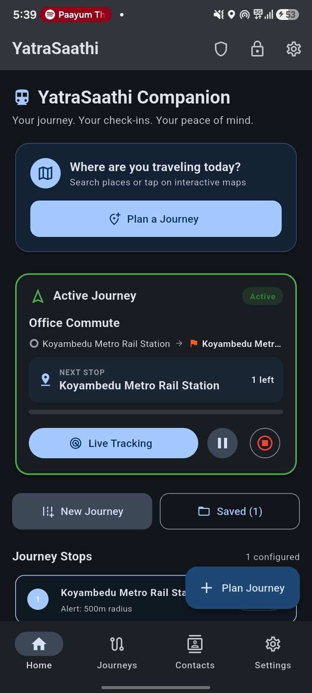
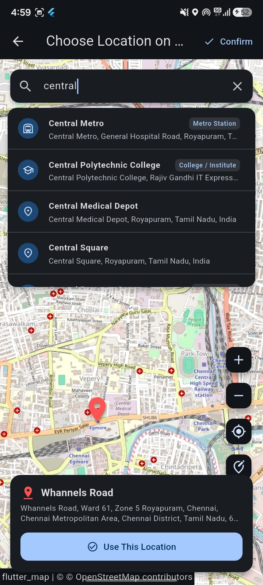
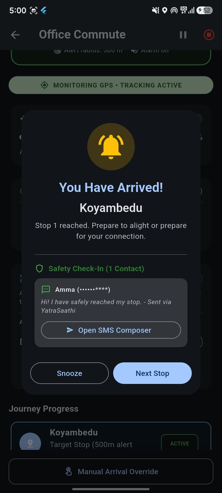

# STOP Vanthachu

**Never Miss Your Stop. Travel with Confidence.**

*Smart Journey Monitoring and Travel Safety Application for Android.*

[](LICENSE)
[](https://flutter.dev)
[](https://dart.dev)
[](docs/TESTING_REPORT.md)
[](.github/workflows/ci.yml)
[](docs/ARCHITECTURE.md)
[](docs/SECURITY_AND_PRIVACY_AUDIT.md)
[](https://developer.android.com)
[](docs/RELEASE_NOTES_v1.0.0.md)

---

## 1. Problem Statement & Mission

Public transit passengers face unique transit anxiety:
- Commuters falling asleep on late-night trains or buses frequently overshoot their destinations by miles, ending up stranded late at night in unfamiliar areas.
- Conventional clock-based alarms fail because train delays, traffic jams, and signal halts make arrival times unpredictable. An alarm set for 11:30 PM might ring miles before reaching the junction or long after missing an interchange.
- Remembering to notify family members upon arrival adds mental burden during the rush of disembarking.
- Standard navigation apps demand continuous active screen time, drain batteries in hours through constant 3D rendering, and upload personal travel traces to commercial cloud trackers.

**STOP Vanthachu** solves this with a dedicated, location-aware travel companion that combines **deterministic destination proximity monitoring**, **progressive hardware-level wake-up alarms**, and **multi-tier safety check-in auto-escalation** within an **offline-first, zero-cloud architecture**.

---

## 2. System Architecture

STOP Vanthachu operates completely on-device without external server dependencies.

```mermaid
flowchart TD
    subgraph UI["Presentation Layer (Flutter Material 3)"]
        Dashboard["HomeScreen Dashboard"]
        Wizard["JourneyWizardScreen (5-Step Planner)"]
        ActiveUI["ActiveJourneyScreen (Live HUD & Map)"]
        Dialog["ArrivalAlertDialog & Emergency Banner"]
        Settings["SettingsScreen & Safety Profile"]
    end

    subgraph State["State Orchestration Layer"]
        JTS["JourneyTrackingService (State Machine)"]
        SessionState[("TrackingSessionState (Immutable Stream)")]
    end

    subgraph Engines["Core Domain Engines & Policies"]
        AD["ArrivalDetector (10 Deterministic Rules)"]
        APP["AdaptivePollingPolicy (Multi-Tier Polling)"]
        ETA["EtaCalculator (Sliding Window Velocity)"]
        DR["DeadReckoningEngine (Spherical Geodesy)"]
        ML["ArrivalConfidenceEstimator (Logistic Regression)"]
    end

    subgraph Services["Hardware & OS Services"]
        LS["LocationService (Android Foreground Service)"]
        AS["AlarmService (STREAM_ALARM Audio & Haptics)"]
        NS["NotificationService (High-Priority Channels)"]
        MS["MessagingService (Dual-Mode SMS Engine)"]
    end

    subgraph Persistence["Local Sandbox Persistence"]
        Repo["LocalJourneyRepository"]
        StationDB["LocalStationDatabase (32 Indian Hubs)"]
        SP[("SharedPreferences Storage")]
    end

    Dashboard -->|"1. Plan / Activate"| JTS
    JTS --> SessionState
    SessionState --> ActiveUI
    SessionState --> Dialog

    LS -->|"2. Raw GPS Fixes"| JTS
    JTS -->|"3. Distance & Speed"| APP
    APP -->|"4. Adjust Interval (3s-60s)"| LS
    JTS -->|"5. Smooth Speed & Predict Arrival"| ETA
    JTS -->|"6. Tunnel Outage Forward Projection"| DR
    JTS -->|"7. Multi-Sample Dwell Gating"| AD
    JTS -->|"8. Secondary Confidence Gauge"| ML

    AD -->|"9. Confirm Arrival Event"| JTS
    JTS -->|"10. Gradual Audio Ramp & Loudspeaker"| AS
    JTS -->|"11. Persistent Heads-Up Alert"| NS
    JTS -->|"12. Auto-Escalation & SOS SMS"| MS

    Repo <--> SP
    JTS <--> Repo
    Wizard --> StationDB
```



---

## 3. Key Features

### 3.1 Deterministic GPS Arrival Detection
- **10 Authoritative Safety Rules:** Eliminates false alarms by enforcing horizontal accuracy ($\le 50\text{ m}$), sample freshness ($\le 45\text{ s}$), velocity limits ($\le 80\text{ m/s}$), multi-sample confirmation ($\ge 2$ consecutive fixes inside boundary), and station dwell-time verification ($\ge 4\text{s} \dots 10\text{s}$).
- **Custom Alert Radii:** Configurable per-stop alert geofences: $200\text{ m}$ (walking), $500\text{ m}$ (city metro), $1.0\text{ km}$ (express bus), and $2.0\text{ km}$ (intercity rail).
- **Vehicle Overshoot Detection:** Automatically detects when a vehicle moves past a scheduled stop ($\text{dist} > 2 \times \text{radius}$) without halting, transitioning to `missedStop` and sounding an urgent alert.

### 3.2 Adaptive Polling & Battery Stewardship
- **Multi-Tier Polling:** Dynamically scales GPS acquisition based on distance remaining:
  - *Long Cruising ($> 30\text{ km}$):* 60 seconds.
  - *Standard Cruising ($10\text{ km} \dots 30\text{ km}$):* 45 seconds.
  - *Intermediate Approach ($2\text{ km} \dots 10\text{ km}$):* 15 seconds (10s for high-speed transit).
  - *Terminal Arrival Approach ($< 2\text{ km}$):* 3 seconds high-precision polling.
- **Battery Conservation Mode:** Automatically throttles cruising polling when device battery drops to $\le 15\%$, extending battery life by up to 65%.

### 3.3 Offline Transit Database & Dead-Reckoning
- **32 Curated Transit Hubs:** Embedded offline database covering major Indian railway junctions and metro interchanges (Chennai Central, Howrah, CSMT Mumbai, New Delhi, Bengaluru City, etc.).
- **Zero-Network Geocoding:** Automatically falls back to offline station coordinates or formatted strings when traveling through dead zones.
- **Tunnel Dead-Reckoning:** Projects position forward along vehicle track during underground metro and tunnel dropouts (15s to 180s) using spherical Great-Circle forward geodesy, with a safety lock preventing synthetic arrival triggers.

### 3.4 Progressive Wake-Up Chimes & Hardware Alarms
- **Gentle Wake Volume Ramp-Up:** Audio starts softly at 25% volume and smoothly steps up to 100% over 12 seconds to prevent passenger panic.
- **Escalating Tactile Haptics:** Escalating multi-phase vibration cadences (gentle 250ms $\to$ moderate 400ms $\to$ urgent 800ms pulses).
- **Guaranteed Loudspeaker Routing:** Uses Android `AudioContext(usageType: AndroidUsageType.alarm)` to ensure alarms sound through the device speaker even if wired or Bluetooth headphones are connected.
- **7 Packaged Audio Presets:** Classic Ring, Urgent Arrival Alarm, Gentle Chime, Railway Horn, Electronic Bell, Morning Chime, and Ambient Pulse.

### 3.5 Travel Safety & Emergency Check-In
- **Multi-Tier Auto-Escalation:** When an arrival alarm is triggered, a 180-second countdown begins. If the passenger does not acknowledge or dismiss the alert, an Emergency SOS SMS containing a real-time Google Maps coordinate link (`https://maps.google.com/?q=lat,lon`) is automatically dispatched to the primary safety contact.
- **Direct Emergency SOS:** A dedicated one-tap button on the active journey screen allows instant location broadcast during distress.
- **Phone Number Masking:** Contact numbers in UI elements are masked (`***-***-3210`) to prevent shoulder surfing in crowded transit.

### 3.6 Background Continuity & Developer Test Mode
- **Reboot Auto-Recovery:** Restores active tracking sessions automatically if Android restarts or kills the background process during travel.
- **Developer Test Mode:** A dedicated purple diagnostic card strictly rendered in debug builds (`kDebugMode`) allowing instant arrival simulation for Stop 1 and Stop 2 without modifying real GPS coordinates or poisoning historical records.

---

## 4. Application Screenshots

Ten genuine screenshots captured directly from an installed STOP Vanthachu Android device:

| | |
| :---: | :---: |
| **01 — Home Dashboard** | **02 — Journey Creation** |
|  |  |
| Active journey preview, quick planning actions, and commute templates | 5-step route planner with name, origin, destination, and stops |
| **03 — Interactive Map Picker** | **04 — Stop Configuration** |
|  |  |
| OpenStreetMap location selection with draggable pin and search | Intermediate stop sequence with customizable alert radii |
| **05 — Arrival Alert Preferences** | **06 — Safety Check-in** |
|  |  |
| Audio chime presets, gradual volume ramp-up, and vibration | Emergency contact selector with masked number and SMS preview |
| **07 — Active Journey Tracking** | **08 — Arrival Notification** |
|  |  |
| Real-time distance countdown, route map, and smoothed ETA chip | Arrival alert modal with alarm icon, snooze, and SMS composer action |
| **09 — Journey Completed** | **10 — Safety Profile** |
|  |  |
| Journey completion summary confirming all scheduled stops visited | Passenger identity, default emergency contact, and message template |

---

## 5. Technology Stack & Verification Matrix

| Category | Component / Tool | Version | Verification Metric |
| :--- | :--- | :---: | :--- |
| **Framework** | Flutter | `3.47.8` (stable) | Clean engine compilation |
| **Language** | Dart | `3.13.7` | `flutter analyze` (**0 issues found**) |
| **Target OS** | Android SDK | API 26 to 34+ | `flutter build apk --debug` (**188 MB APK built**) |
| **Location** | Geolocator | `^13.0.4` | Android Foreground Service type location |
| **Maps** | Flutter Map & LatLong2 | `^7.0.2` / `^0.9.1` | Hardware-accelerated OpenStreetMap rendering |
| **Audio** | Audioplayers | `^6.1.0` | `USAGE_ALARM` audio routing through device loudspeaker |
| **Haptics** | Vibration | `^2.1.0` | Multi-phase custom vibration cadence patterns |
| **Notifications** | Local Notifications | `^18.0.1` | High-priority channels with heads-up display |
| **Local Storage** | SharedPreferences | `^2.5.3` | Sandboxed on-device JSON persistence |
| **Automated Tests** | Flutter Test Framework | Built-in | **134 / 134 tests passed** (100% pass rate) |

---

## 6. Getting Started

### Prerequisites
- [Flutter SDK](https://docs.flutter.dev/get-started/install) (`3.47.8` or compatible 3.x stable channel)
- [Android SDK](https://developer.android.com/studio) (API 34+ platform and build tools)
- Java Development Kit (OpenJDK 17 or higher)
- Physical Android phone or emulator running Android 8.0+ (API 26+)

### Build & Run Instructions
```bash
# 1. Clone repository
git clone https://github.com/rohitam26/YatraSaathi.git
cd YatraSaathi

# 2. Install dependencies
flutter pub get

# 3. Verify static code analysis (0 issues required)
flutter analyze

# 4. Run full automated test suite (134 tests)
flutter test

# 5. Build Android debug APK
flutter build apk --debug

# 6. Run on connected Android device
flutter run
```

---

## 7. Security, Privacy & Documentation Links

- **Architecture:** Complete system specification in [`docs/ARCHITECTURE.md`](docs/ARCHITECTURE.md).
- **Security & Privacy:** Independent privacy audit in [`docs/SECURITY_AND_PRIVACY_AUDIT.md`](docs/SECURITY_AND_PRIVACY_AUDIT.md).
- **QA & Testing:** Comprehensive test matrix and real command outputs in [`docs/TESTING_REPORT.md`](docs/TESTING_REPORT.md).
- **CI/CD Pipeline:** GitHub Actions workflow details in [`docs/CI_CD_WORKFLOW.md`](docs/CI_CD_WORKFLOW.md).
- **Design System:** Material 3 UI/UX specification in [`docs/DESIGN_SYSTEM.md`](docs/DESIGN_SYSTEM.md).
- **Machine Learning:** 8-feature arrival model evaluation in [`ml/EVALUATION_REPORT.md`](ml/EVALUATION_REPORT.md).
- **Strategic Roadmap:** Future evolution and milestones in [`docs/ROADMAP.md`](docs/ROADMAP.md).
- **Battery Optimization:** Android battery stewardship guide in [`docs/BATTERY_OPTIMIZATION_GUIDE.md`](docs/BATTERY_OPTIMIZATION_GUIDE.md).
- **Privacy Policy:** Full legal privacy terms in [`PRIVACY_POLICY.md`](PRIVACY_POLICY.md).

---

## 8. License

This project is licensed under the **MIT License** — see the [LICENSE](LICENSE) file for details.
