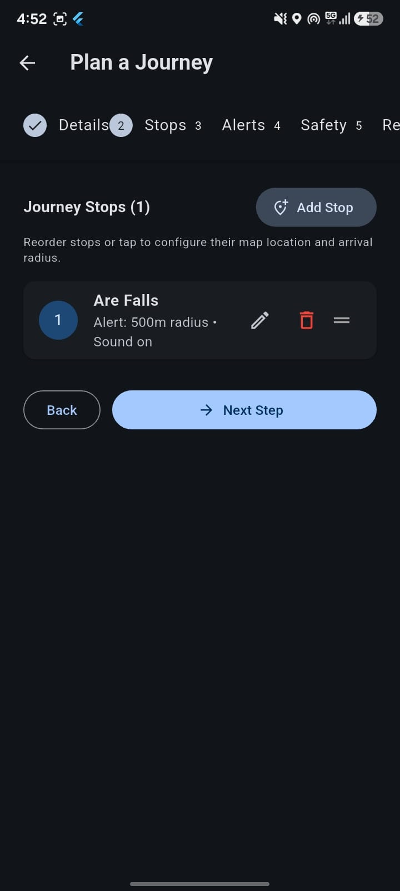
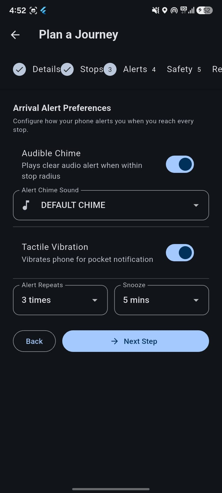
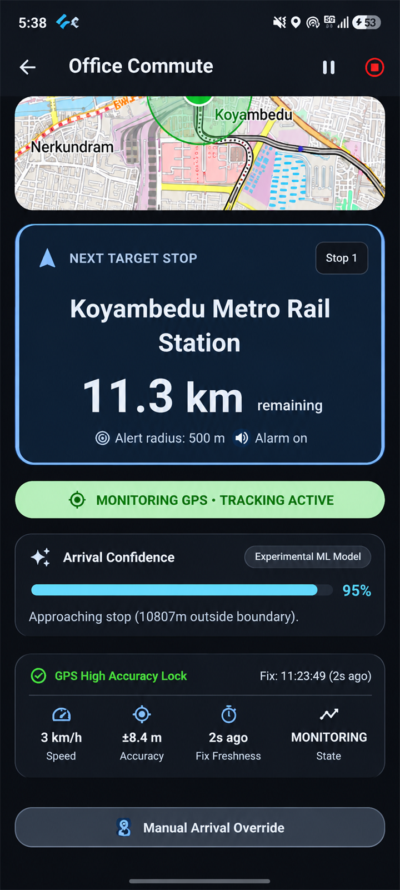

# YatraSaathi

> **A journey companion that helps travellers avoid missing stops and stay connected with their families.**

[](LICENSE)
[](https://flutter.dev)
[](https://dart.dev)
[]()

---

## About the Project

I often found myself worrying about missing my stop while travelling. Whether on a crowded train, a long distance bus, or an unfamiliar route, it is easy to lose track of your journey. I wanted to build something that would alert me when I reached my destination and help keep my family informed without relying on me to remember every check-in.

YatraSaathi is a GPS-powered journey monitoring and personal travel safety application developed to address these everyday challenges.

Designed as a digital travel companion, YatraSaathi enables users to plan journeys with multiple stops, monitor their location during transit, and receive audible alerts when approaching or reaching a designated destination. It also integrates safety contact management and arrival check-in messaging to help users keep their trusted contacts informed throughout their journey.

The application brings together location intelligence, proximity-based arrival detection, configurable alarm notifications, and safety messaging within a unified mobile experience. Its design prioritises practical usability, user control, and privacy-conscious handling of journey information.

Rather than requiring travellers to continuously monitor a navigation screen, YatraSaathi aims to make journey awareness more proactive, helping users stay informed while they focus on travelling.

---

## Problem Statement

Daily commuters and long-distance passengers face recurring transit challenges:

- **Unintended Destination Overshooting:** : Passengers may fall asleep, become distracted, or lose awareness of their location, resulting in missed destinations and intermediate stops.
- **Continuous Screen Dependency** Traditional navigation experiences often require users to periodically check their devices, which can be inconvenient during long journeys, crowded commutes, or periods of rest.
- **Limited Personalised Arrival Alerts:** General-purpose navigation tools may not provide the combination of configurable proximity-based alerts, repeatable alarms, and journey-specific safety check-ins that some commuters need.
- **Inconsistent Safety Check-ins:** Travellers may forget to notify family members or trusted contacts after reaching their destination, creating unnecessary uncertainty for people waiting for confirmation.
- **Privacy and Data Dependence:** Location-based applications can introduce concerns around continuous location sharing, account requirements, and the handling of personal travel information.


YatraSaathi addresses these needs with a 100% offline first architecture, deterministic GPS arrival detection, hardware level alarms, and privacy respecting safety messaging.

---

## Key Features

### 1. Multi-Stop Journey Planning with Interactive Map
- Plan journeys with intermediate transit stops and a final destination.
- **OpenStreetMap Picker:** Select destinations visually on OpenStreetMap with zoom, pan, place search, and current-location pin dropping (no manual latitude/longitude entry needed).
- Dynamic stop reordering and customizable arrival alert radii (200 m, 500 m, 1 km, 2 km).

### 2. Dedicated Arrival Ringtone System
- **Original Local Ringtones:** Includes 3 original packaged audio ringtones designed for transit:
  - **Classic Ring:** Telephone bell cadence with dual-frequency modulation.
  - **Urgent Arrival Alarm:** Rapid alert siren pulses that cut through noisy road and rail environments.
  - **Gentle Chime:** Melodic pentatonic chime arpeggio with soft decay.
- **Audio Preview:** Instant play/pause auditioning directly in Settings and stop configuration with a volume slider.
- **Background Speaker Playback:** Configured with Android `STREAM_ALARM` (`AudioContextAndroid`) to sound through device speakers even in silent mode when permitted.
- **Continuous Alert Controls:** Repeat-until-dismissed playback, snooze timers (5 mins), and explicit dismissal.

### 3. Passenger Safety Profile & Emergency Contacts
- Save your passenger details, emergency mobile numbers, and default check-in message template once in Settings.
- Manage multiple trusted safety contacts with relationship tags (Parent, Partner, Sibling, Friend).
- Individual stops can override safety contacts or inherit default settings automatically.

### 4. Safety Check-In Messaging
- **Native SMS Composer Fallback (Default):** Launches the native Android SMS app pre-filled with recipient and personalized arrival text. 100% compliant with Google Play Store permissions policies.
- **Direct Background SMS Mode (Private APK Distribution):** Supports automated SMS dispatch via Android `SmsManager` for privately distributed builds when explicit user consent and runtime permissions are granted.
- **Integrity Safeguards:** Duplicate alert suppression, recipient validation, and SIM readiness verification.

### 5. Deterministic GPS Arrival Detection
- Haversine spherical distance calculation with GPS accuracy filtering (rejects noisy readings > 65 m).
- Consecutive reading confirmation (\(\ge 2\) fixes) and dwell-time validation to prevent false alarms during express fly-bys.
- Operates in the background as an Android Foreground Service with ongoing status bar notifications.

### 6. Developer Test Mode
- Isolated debug-only simulation mode that exercises downstream alarm playback, notification posting, and SMS check-in workflows for two-stop journeys without altering real GPS coordinates.

---

## Technology Stack

- **Framework:** Flutter 3.47.8 (Channel stable)
- **Language:** Dart 3.13.7
- **Target Platform:** Android (API 26 to API 35+)
- **Audio Playback:** `audioplayers ^6.1.0`
- **Mapping:** `flutter_map ^7.0.2` & `latlong2 ^0.9.1` (OpenStreetMap tile layer)
- **Notifications:** `flutter_local_notifications ^18.0.1` (High-priority alarm notification channel)
- **Location Services:** `geolocator ^13.0.2` (Background foreground service)
- **Haptics:** `vibration ^2.1.0` (Custom hardware vibration patterns)
- **Local Persistence:** `shared_preferences ^2.5.6` (Encrypted JSON preferences)
- **External Intents:** `url_launcher ^6.3.1` (Native SMS composer intents)

---

## Application Walkthrough & Genuine Screenshots

YatraSaathi is designed with an intuitive, accessible interface optimized for travellers on the move. Explore the core application workflow captured directly from the installed Android application:

| Home Dashboard | Journey Creation | Interactive Map Picker |
| :---: | :---: | :---: |
|  |  |  |
| **01. Home Dashboard**<br><sub>Companion overview, active journey banner & saved routes</sub> | **02. Journey Creation**<br><sub>Multi-step route wizard with start point and destination</sub> | **03. Interactive Map Picker**<br><sub>OpenStreetMap pin placement with live place search</sub> |

| Stop Configuration | Arrival Alert Preferences | Safety Check-in |
| :---: | :---: | :---: |
|  |  |  |
| **04. Stop Configuration**<br><sub>Intermediate stop management and 500m alert radius</sub> | **05. Arrival Alert Preferences**<br><sub>Audible chime selection, vibration & snooze timing</sub> | **06. Safety Check-in**<br><sub>Emergency contact selection and SMS preview</sub> |

| Active Journey Tracking | Arrival Notification | Journey Completed | Safety Profile |
| :---: | :---: | :---: | :---: |
|  |  |  |  |
| **07. Active Journey Tracking**<br><sub>Real-time distance countdown, GPS lock & arrival confidence</sub> | **08. Arrival Notification**<br><sub>Loud arrival modal with one-tap SMS composer launch</sub> | **09. Journey Completed**<br><sub>Trip completion summary and return to dashboard</sub> | **10. Safety Profile**<br><sub>Passenger identity and default emergency contacts</sub> |

> [!NOTE]
> All ten screenshots are genuine Android application captures with masked phone numbers. Complete documentation is provided in [`assets/screenshots/README.md`](assets/screenshots/README.md).

---

## Installation & Setup

### Prerequisites
- [Flutter SDK](https://docs.flutter.dev/get-started/install) (version 3.47.8 or higher)
- [Android Studio / Android SDK](https://developer.android.com/studio) (API 34+ platform and build-tools)
- Java Development Kit (OpenJDK 17 or higher)

### Build Instructions

1. **Clone the repository:**
   ```bash
   git clone https://github.com/rohitam26/YatraSaathi-.git
   cd YatraSaathi-
   ```

2. **Install Flutter dependencies:**
   ```bash
   flutter pub get
   ```

3. **Verify analyzer status:**
   ```bash
   flutter analyze
   ```

4. **Run the automated test suite:**
   ```bash
   flutter test
   ```

5. **Build the debug APK for local testing:**
   ```bash
   flutter build apk --debug
   ```
   The built APK will be located at `build/app/outputs/flutter-apk/app-debug.apk`.

6. **Install to an attached Android device:**
   ```bash
   adb install -r build/app/outputs/flutter-apk/app-debug.apk
   ```

---

## Usage Guide

1. **First Launch Onboarding:** Review the privacy principles, grant location access ("While using the app" or "All the time" for background tracking), and allow notifications.
2. **Set Up Safety Profile:** Navigate to **Settings** to set your name, emergency mobile number, default safety contacts, and choose your preferred arrival ringtone.
3. **Create a Journey:** Tap **"New Journey"** on the dashboard. Enter a journey title, pick your destination stops using the interactive OpenStreetMap picker, and set your desired alert radius (e.g. 500 m).
4. **Configure Alarms & Contacts:** Select ringtone sounds (Classic Ring, Urgent Alarm, or Gentle Chime) and choose which contacts should receive check-in messages upon arrival.
5. **Start Tracking:** Tap **"Start Journey"**. The application monitors GPS coordinates in the background with a persistent status notification.
6. **Arrival Alert:** When within the designated arrival radius, your phone sounds the selected ringtone, vibrates, and displays the full-screen arrival alert.
7. **Send Safety Check-In:** The alert displays your pre-configured check-in SMS with one-tap access to your native SMS composer.

---

## Privacy Policy & Data Handling

YatraSaathi is committed to complete user transparency and privacy-first engineering:

- **Complete Policy Documentation:** Read the full legal document in [`PRIVACY_POLICY.md`](PRIVACY_POLICY.md) or view the responsive web page in [`docs/privacy-policy.html`](docs/privacy-policy.html).
- **100% On-Device Location Processing:** GPS coordinates are processed exclusively on your device to calculate distance to upcoming stops. Coordinates are never transmitted to, logged on, or shared with external servers during transit tracking.
- **Local Storage:** All journeys, stops, user profiles, and safety contacts are stored in your device's private `SharedPreferences`. Zero data is uploaded to cloud databases.
- **Zero Third-Party Telemetry:** No analytics SDKs, advertising trackers, or external telemetry libraries are embedded in the application.
- **Map & Geocoding Services:** Map tiles are loaded via HTTPS from OpenStreetMap (`tile.openstreetmap.org`). Destination search and reverse geocoding queries are sent to Komoot Photon (`photon.komoot.io`) and OSM Nominatim (`nominatim.openstreetmap.org`) strictly when actively interacting with the location picker.
- **SMS Telephony Compliance:** In accordance with Google Play Store permissions policies, YatraSaathi uses the native Android SMS composer (`url_launcher` via `sms:`) as its default, secure check-in workflow. Direct background SMS via Android `SmsManager` is restricted to private, user-consented sideload builds.
- **Permissions Overview:** The app requires `ACCESS_FINE_LOCATION`, `ACCESS_BACKGROUND_LOCATION`, `FOREGROUND_SERVICE_LOCATION`, `POST_NOTIFICATIONS`, `VIBRATE`, and `MODIFY_AUDIO_SETTINGS` strictly for core transit alert functionality.

---

## Automated Verification & Testing

The project maintains 100% passing automated test coverage across its services, models, and UI flows:

- **Static Analysis:** `flutter analyze` reports 0 issues (0 errors, 0 warnings, 0 infos).
- **Automated Test Suite:** **90 / 90 tests passed** (`flutter test`).
  - Unit tests for GPS arrival detection and dwell calculation (`arrival_detector_test.dart`).
  - Journey tracking service lifecycle tests (`journey_tracking_service_test.dart`).
  - Ringtone and audio playback tests (`alarm_service_test.dart`).
  - Safety contacts and diagnostics tests (`safety_contacts_and_diagnostics_test.dart`).
  - Multi-stop Developer Test Mode verification (`developer_test_mode_test.dart`).
  - Interactive UI flow and wizard widget tests (`ui_flow_test.dart`, `journey_wizard_test.dart`).

---

## Project Structure

```
YatraSaathi/
├── android/                   # Native Android manifest, Kotlin MainActivity, and Gradle setup
├── assets/
│   ├── screenshots/          # Ten genuine application screenshots (.png)
│   └── sounds/               # Packaged original audio ringtones (.wav)
├── lib/
│   ├── main.dart             # Application entrypoint & Dashboard
│   ├── models/               # Data entities (Journey, Stop, AlarmConfig, UserProfile, etc.)
│   ├── services/             # Core business logic
│   │   ├── alarm_service.dart            # Audio ringtone playback & preview
│   │   ├── arrival_detector.dart         # Haversine distance & dwell validation
│   │   ├── direct_sms_service.dart       # Android SmsManager platform channel
│   │   ├── geocoding_service.dart        # Place search & reverse geocoding
│   │   ├── journey_repository.dart       # Local persistence repository
│   │   ├── journey_tracking_service.dart # Background GPS tracking orchestrator
│   │   ├── location_service.dart         # Geolocator stream & permissions
│   │   ├── messaging_service.dart        # SMS composer & direct dispatch
│   │   └── notification_service.dart     # High-priority alarm notification channels
│   └── ui/                   # Screens, modal dialogs, and reusable widgets
│       ├── active_journey_screen.dart
│       ├── arrival_alert_dialog.dart
│       ├── first_launch_onboarding_screen.dart
│       ├── journey_wizard_screen.dart
│       ├── safety_contacts_screen.dart
│       ├── settings_screen.dart
│       └── widgets/          # MapLocationPicker, RingtoneSelectorWidget, etc.
├── test/                     # 90 automated unit, widget, and integration tests
├── LICENSE                   # MIT License
├── pubspec.yaml              # Flutter dependency manifest
└── README.md                 # Project documentation
```

---

## Contributing

Contributions, bug reports, and suggestions are welcome!

1. Fork the repository.
2. Create a feature branch: `git checkout -b feature/your-feature-name`.
3. Commit your changes: `git commit -m "Add feature description"`.
4. Ensure all tests pass: `flutter test` and `flutter analyze`.
5. Push to your branch: `git push origin feature/your-feature-name`.
6. Open a Pull Request.

---

## License

This project is licensed under the **MIT License** — see the [LICENSE](LICENSE) file for details.

---

## Acknowledgements

- [Flutter](https://flutter.dev) and the Dart team.
- [OpenStreetMap](https://www.openstreetmap.org) contributors for open map tiles and geocoding data.
- Open-source packages: `audioplayers`, `flutter_map`, `geolocator`, `flutter_local_notifications`, `vibration`, `shared_preferences`.
