# STOP Vanthachu — Architecture & Technical Specification

**Application Name:** STOP Vanthachu  
**Official Tagline:** Never Miss Your Stop. Travel with Confidence.  
**Platform:** Android (API 26+)  
**Framework:** Flutter (Dart)  
**Architecture Style:** Layered, Offline-First, Reactive Stream State Machine  
**Safety Classification:** Deterministic-First Hybrid Geofence Engine

---

## 1. Architectural Philosophy

Public transit monitoring is a safety-critical application. If an app fails to wake a sleeping passenger, they may end up miles past their destination at midnight in an unfamiliar town. If an app triggers false alarms constantly, passengers will silence it.

STOP Vanthachu is engineered around four non-negotiable architectural tenets:
1. **Deterministic-First Geofence Gating:** Statistical and ML models are assistive only. Hardware alarms are gated strictly by spherical geometry (Haversine formula), temporal freshness, accuracy error clamping, and verified dwell duration.
2. **Offline-First Data Sovereignty:** Zero cloud dependencies, zero external servers, zero telemetry SDKs. The app continues to operate flawlessly in rural areas, mountain passes, and underground metro tunnels.
3. **Adaptive Hardware Stewardship:** Continuous GPS drains batteries rapidly. Polling rates scale dynamically from 60 seconds (cruising far away) down to 3 seconds (terminal approach), conserving up to 65% of battery.
4. **Resilient Lifecycle Continuity:** Mobile operating systems terminate background processes aggressively under memory pressure. STOP Vanthachu implements a persistent Android Foreground Service with boot-recovery hooks (`RECEIVE_BOOT_COMPLETED`) to ensure journeys survive phone restarts.

---

## 2. Complete System Component Architecture

```mermaid
flowchart TD
    subgraph UI["Presentation Layer (Flutter Material 3)"]
        Dashboard["HomeScreen Dashboard"]
        Wizard["JourneyWizardScreen (5-Step Planner)"]
        ActiveUI["ActiveJourneyScreen (Live HUD & Map)"]
        Dialog["ArrivalAlertDialog & Emergency Banner"]
        Settings["SettingsScreen & Safety Profile"]
    end

    subgraph State["State Orchestration Layer"]
        JTS["JourneyTrackingService (Singleton State Machine)"]
        SessionState[("TrackingSessionState (Immutable Stream)")]
    end

    subgraph Engines["Core Domain Engines & Policies"]
        AD["ArrivalDetector (10 Deterministic Rules)"]
        APP["AdaptivePollingPolicy (Multi-Tier Polling)"]
        ETA["EtaCalculator (Sliding Window Velocity)"]
        DR["DeadReckoningEngine (Spherical Geodesy)"]
        ML["ArrivalConfidenceEstimator (Logistic Regression)"]
    end

    subgraph Services["Hardware & OS Services"]
        LS["LocationService (Android Foreground Service)"]
        AS["AlarmService (STREAM_ALARM Audio & Haptics)"]
        NS["NotificationService (High-Priority Channels)"]
        MS["MessagingService (Dual-Mode SMS Engine)"]
    end

    subgraph Persistence["Local Sandbox Persistence"]
        Repo["LocalJourneyRepository"]
        StationDB["LocalStationDatabase (32 Indian Hubs)"]
        SP[("SharedPreferences Storage")]
    end

    Dashboard -->|"1. Plan / Activate"| JTS
    JTS --> SessionState
    SessionState --> ActiveUI
    SessionState --> Dialog

    LS -->|"2. Raw GPS Fixes"| JTS
    JTS -->|"3. Distance & Speed"| APP
    APP -->|"4. Adjust Interval (3s-60s)"| LS
    JTS -->|"5. Smooth Speed & Predict Arrival"| ETA
    JTS -->|"6. Tunnel Outage Forward Projection"| DR
    JTS -->|"7. Multi-Sample Dwell Gating"| AD
    JTS -->|"8. Secondary Confidence Gauge"| ML

    AD -->|"9. Confirm Arrival Event"| JTS
    JTS -->|"10. Gradual Audio Ramp & Loudspeaker"| AS
    JTS -->|"11. Persistent Heads-Up Alert"| NS
    JTS -->|"12. Auto-Escalation & SOS SMS"| MS

    Repo <--> SP
    JTS <--> Repo
    Wizard --> StationDB
```



---

## 3. Layer Specifications

### 3.1 Presentation Layer (`lib/ui/`)
- Built with Flutter Material 3, adhering to WCAG 2.1 AA accessibility standards.
- Reactive: Listens to `JourneyTrackingService.stateStream` and repaints only affected widgets.
- Contains specialized screens:
  - `HomeScreen`: Dashboard, quick actions, active journey card, commute schedule chips.
  - `JourneyWizardScreen`: 5-step sequential journey builder with location search.
  - `ActiveJourneyScreen`: Real-time tracking HUD, live OpenStreetMap canvas, speed and accuracy meters, emergency SOS escalation banner.
  - `ArrivalAlertDialog`: High-urgency alert modal with snooze, dismiss, and SMS check-in actions.
  - `SettingsScreen`: User safety profile, default contact configuration, ringtone preferences, and one-tap local data erasure.

### 3.2 State Orchestration Layer (`lib/services/journey_tracking_service.dart`)
- Acts as the central finite state machine (FSM) governing journey lifecycles:
  $$\text{idle} \longrightarrow \text{monitoring} \longrightarrow \text{potentialArrival} \longrightarrow \text{alertTriggered} \longrightarrow \text{stopCompleted} \longrightarrow \text{journeyCompleted}$$
  *(With branch states for `paused`, `cancelled`, and `missedStop`).*
- Broadcasts immutable `TrackingSessionState` instances across a broadcast stream.
- Manages multi-stop sequencing: advancing to intermediate stops or completing the final destination.
- Runs the 180-second unacknowledged emergency escalation countdown.

### 3.3 Core Domain Engines & Policies
1. **Deterministic Arrival Detector (`ArrivalDetector`):**
   - 10 strict evaluation rules:
     - Rejects stale fixes ($> 45\text{s}$).
     - Rejects noisy horizontal fixes ($> 50\text{m}$).
     - Filters kinematic sensor noise ($> 80\text{ m/s}$ or $288\text{ km/h}$).
     - Requires distance $\le \text{radius}$.
     - Requires $\ge 2$ consecutive consistent readings inside radius.
     - Enforces minimum station dwell duration ($\ge 4\text{s} \dots 10\text{s}$).
     - Locks out synthetic dead-reckoning samples from triggering physical arrival.
2. **Adaptive Polling Policy (`AdaptivePollingPolicy`):**
   - Dynamically scales GPS polling frequency based on physical distance to the upcoming stop:
     - **Long Cruising ($> 30\text{ km}$):** 60-second polling.
     - **Standard Cruising ($10\text{ km} \dots 30\text{ km}$):** 45-second polling.
     - **Intermediate Approach ($2\text{ km} \dots 10\text{ km}$):** 15-second polling (accelerated to 10s if vehicle speed $> 100\text{ km/h}$).
     - **Terminal Approach ($< 2\text{ km}$):** 3-second high-precision polling.
     - **Battery Conservation Mode ($\le 15\%$ battery):** 90s cruising, 60s intermediate, 3s terminal approach.
3. **Smoothed ETA Calculator (`EtaCalculator`):**
   - Maintains a 10-sample rolling window of instantaneous speeds.
   - Filters out negative velocities and anomalous spikes.
   - Falls back to a transit signal/halt velocity ($8.33\text{ m/s} \approx 30\text{ km/h}$) when the vehicle is stationary at signals or stations.
4. **Dead-Reckoning Engine (`DeadReckoningEngine`):**
   - Detects GPS dropouts in underground metro tunnels and deep canyons.
   - For dropouts between 15s and 180s, projects current position along vehicle track using spherical Great-Circle forward geodesy.
   - Smoothly inflates uncertainty radius ($\text{acc} + \Delta t \times 0.5$, clamped to 150m).
5. **Experimental Machine Learning Engine (`ArrivalConfidenceEstimator`):**
   - 8-feature regularized logistic regression evaluating kinematic telemetry.
   - Runs 100% on-device in $< 0.02\text{ ms}$ with zero network calls and $< 3\text{ KB}$ memory footprint.

### 3.4 Hardware & Operating System Integration
- **Foreground Service:** Runs Android `GeolocatorLocationService` with `foregroundServiceType="location"`. Shows a persistent notification ensuring Android never kills the process during deep sleep.
- **Audio Routing:** Configured with `AudioContextAndroid(usageType: AndroidUsageType.alarm)`. Routes alarm chime directly through hardware loudspeaker even if wired or Bluetooth headphones are connected.
- **Tactile Haptics:** Escalating multi-phase vibration cadences (gentle 250ms $\to$ moderate 400ms $\to$ urgent 800ms pulses).
- **Messaging Service:** Native `ACTION_SENDTO` SMS composer integration with optional direct `SmsManager` mode for private distributions.

---

## 4. Data Flow & Security Boundaries

```text
[Hardware GPS Antenna]
         │ (NMEA / Android Location Provider)
         ▼
[LocationService / Geolocator]
         │ GpsReading (lat, lon, accuracy, speed, timestamp)
         ▼
[JourneyTrackingService (Memory Boundary)]
   ├──> [ArrivalDetector] ──> Deterministic Verification
   ├──> [AdaptivePollingPolicy] ──> Dynamic Interval Adjustment
   ├──> [EtaCalculator] ──> Rolling Speed Smoothing
   ├──> [DeadReckoningEngine] ──> Forward Geodesy
   └──> [ArrivalConfidenceEstimator] ──> Statistical Telemetry
         │
         ▼ Confirmed Arrival Event
   ├──> [AlarmService] ──> Hardware Audio / Haptics
   ├──> [NotificationService] ──> System Tray Notification
   └──> [MessagingService] ──> System SMS Composer (Zero PII leak)
         │
         ▼
[Android SharedPreferences (Encrypted App-Private Sandbox)]
   ├── yatrasaathi_saved_journeys_v1
   ├── yatrasaathi_active_journey_id_v1
   ├── yatrasaathi_user_profile_v1
   ├── yatrasaathi_safety_contacts_v1
   └── yatrasaathi_commute_schedules_v1
```

All data stays strictly within device sandbox storage (`/data/data/com.example.pathsaathi/`). No telemetry, analytics, or location crumbs ever leave the user's phone.
