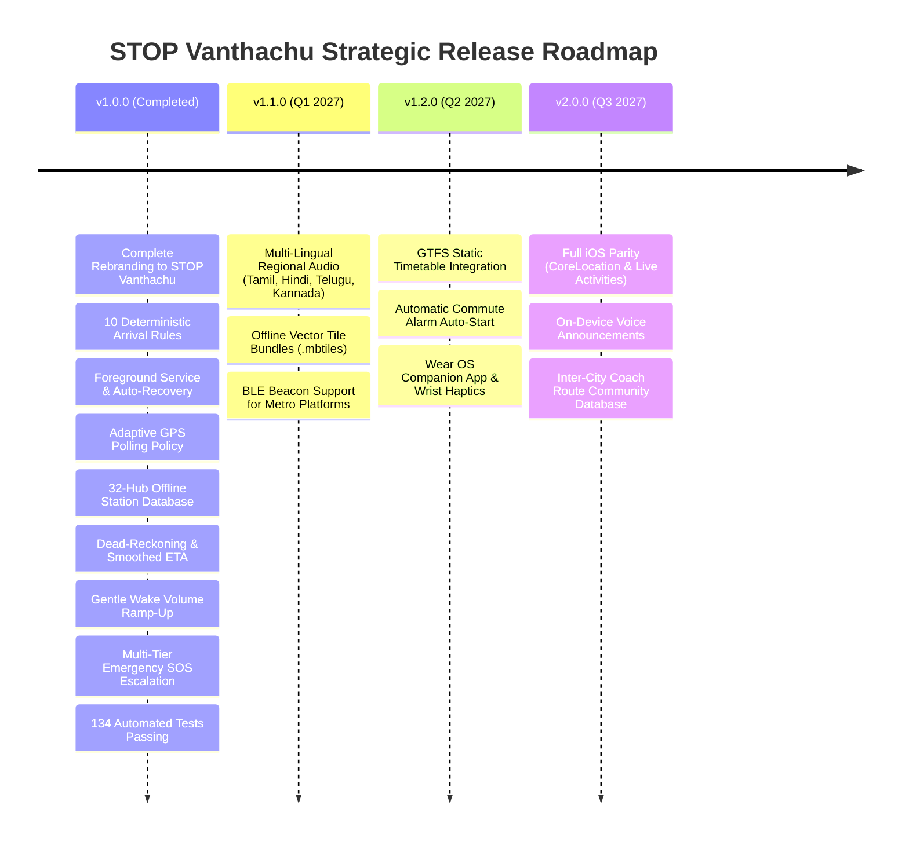

# STOP Vanthachu — Strategic Engineering Roadmap

**Project:** STOP Vanthachu  
**Tagline:** Never Miss Your Stop. Travel with Confidence.  
**Version:** 1.0.0 (Current Release)  
**Target:** 2026–2027 Evolution

---

## 1. Release Milestone Map

---

## 2. Release Objectives & Technical Scope

### 2.1 Version 1.1.0 — Multilingual Announcements & Offline Vector Maps
- **Regional Voice Announcements:** Synthesize arrival announcements in regional languages (Tamil, Hindi, Telugu, Kannada, Malayalam, Marathi, Bengali) using offline Android TTS engines.
- **Offline Vector Tile Support:** Package `.mbtiles` vector packages for popular Indian railway and suburban metro networks, completely eliminating network tile downloads during long journeys.
- **Underground BLE Beacon Positioning:** Integrate Bluetooth Low Energy (BLE) scanning for major underground metro networks (Chennai Metro, Delhi Metro, Namma Metro) to maintain 100% position accuracy even deep underground.

### 2.2 Version 1.2.0 — GTFS Timetables & Wear OS Companion
- **GTFS Static Schedule Integration:** Import open GTFS transit schedules to cross-reference physical GPS arrival with scheduled timetable stops.
- **Automated Commute Activation:** Automatically prompt the user to start tracking their daily commute based on time of day and departure location proximity.
- **Wear OS Smartwatch Companion:** Display live distance countdown and deliver high-priority wrist vibration patterns directly on Android Wear smartwatches.

### 2.3 Version 2.0.0 — iOS Parity & Cross-Platform Transit Community
- **iOS Platform Release:** Port background location architecture to Apple's `CoreLocation` framework with support for iOS Dynamic Island and Live Activities.
- **Crowd-Curated Transit Geofences:** Allow users to export and share validated station geofences via encrypted QR codes or peer-to-peer Wi-Fi Direct without centralized servers.
